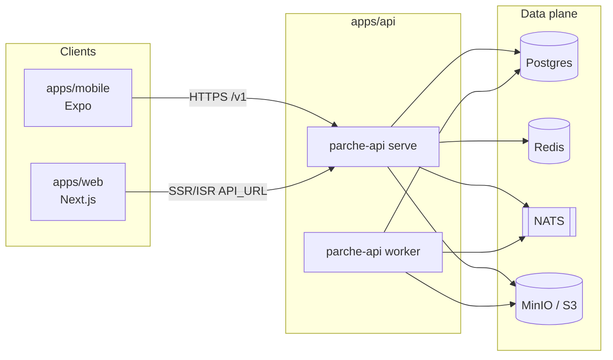

# Parche

Monorepo de carpetas de **Parche** — app para eventos en vivo. Tres apps **independientes** en un solo git (sin workspace pnpm compartido ni Turborepo):

| App | Path | Stack | Instalar / correr |
|-----|------|--------|-------------------|
| Móvil | [`apps/mobile`](apps/mobile) | Expo 57 · NativeWind | `cd apps/mobile && pnpm install && pnpm start` |
| API | [`apps/api`](apps/api) | Go 1.26 · Compose | `cd apps/api && cp .env.example .env && COMPOSE_PARALLEL_LIMIT=1 docker compose up --build` |
| Web | [`apps/web`](apps/web) | Next.js 16 | `cd apps/web && pnpm install && pnpm dev` |

Repo: [github.com/bue221/parche-app](https://github.com/bue221/parche-app) · Docs: [`docs/Home.md`](docs/Home.md) (en el repo; GitHub Wiki no está disponible en privado Free)

## Arquitectura



Cada app tiene su propio lockfile / `go.mod`, `.env` y docs. La raíz solo aporta README, wiki, CI y atajos opcionales (`pnpm dev:mobile`, etc.).

## Requisitos

- **Node** ≥ 22.13 y **pnpm** 12.3.4 (`corepack enable`) — solo mobile y web
- **Go** 1.26+ y/o **Docker Desktop** — API
- Xcode / Android Studio — nativo opcional

## Setup rápido

```bash
git clone https://github.com/bue221/parche-app.git
cd parche-app

cp apps/api/.env.example apps/api/.env
cp apps/mobile/.env.example apps/mobile/.env
cp apps/web/.env.example apps/web/.env

# Terminal A — API
cd apps/api && COMPOSE_PARALLEL_LIMIT=1 docker compose up --build

# Terminal B — mobile
cd apps/mobile && pnpm install && pnpm start

# Terminal C — web
cd apps/web && pnpm install && pnpm dev
```

Atajos desde la raíz (no instalan deps; asumen `pnpm install` ya hecho en cada app JS):

| Script | Equivalente |
|--------|-------------|
| `pnpm dev:api` | Compose en `apps/api` |
| `pnpm dev:mobile` | `pnpm --dir apps/mobile start` |
| `pnpm dev:web` | `pnpm --dir apps/web dev` |
| `pnpm lint` / `pnpm test` | lint/test por app en secuencia |

## Estructura

```text
parche-app/
├── apps/
│   ├── mobile/   # Expo (pnpm propio)
│   ├── api/      # Go + Docker Compose
│   └── web/      # Next.js (pnpm propio)
├── docs/         # Documentación del monorepo (fuente de verdad)
├── scripts/publish-wiki.sh  # solo si tienes Wiki (Pro / repo público)
├── .github/workflows/
├── package.json  # solo scripts atajo (sin dependencies)
├── README.md
└── CLAUDE.md
```

## Documentación

Índice: [`docs/Home.md`](docs/Home.md). Reglas por app: `apps/*/AGENTS.md`.

GitHub Wiki no está disponible en este repo **privado Free**. Edita `docs/` y haz commit. Con Pro (o repo público) puedes habilitar Wiki y usar `pnpm wiki:publish`.

## Contribuir

1. Rama desde `main`; toca solo la app necesaria.
2. CI corre lint/test **por paths** (`apps/mobile/**`, etc.).
3. Nunca commits de `.env`; usa los `.env.example`.
4. Conventional Commits en inglés: `feat(mobile): …`, `fix(api): …`.

Detalle: [`docs/Contributing.md`](docs/Contributing.md).
