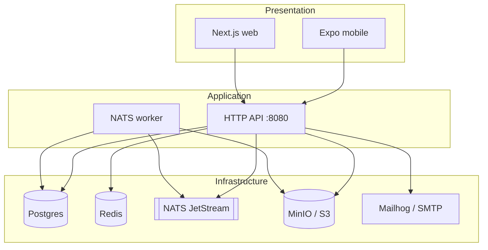
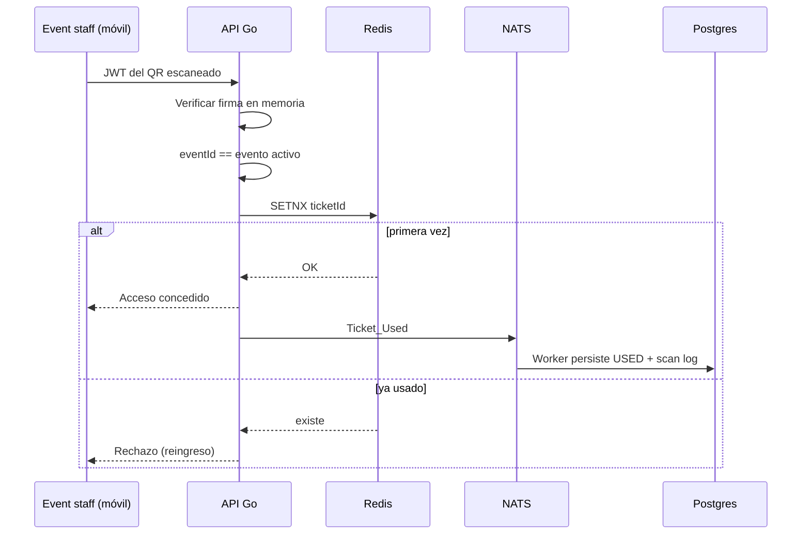

# Arquitectura

Vista del monorepo actual, enriquecida con decisiones del documento de Prácticas IV (flujo QR, multi-tenancy, stack).

## Vista general

Los dos canales de cliente convergen en **una API Go**. La API usa cola + workers para trabajo asíncrono, y Postgres (fuente de verdad) + Redis (caché / coordinación de baja latencia).

## Stack (por qué)

| Capa | Tecnología | Justificación |
|------|------------|----------------|
| App móvil | Expo / React Native | iOS+Android; cámara para QR; canal principal de producto |
| Web | Next.js (SSR/ISR) | SEO, landing y fichas públicas — no sustituye a la app |
| API | Go | Concurrencia eficiente en picos de puerta |
| Cola | NATS | Desacopla respuesta al usuario de persistencia / jobs |
| Caché | Redis | SETNX / lecturas rápidas sin latencia de disco |
| Datos | PostgreSQL | Relacional maduro; multi-tenant lógico; particiones a futuro |
| Objetos | MinIO / S3 | Flyers y media |

## Límites

- **mobile / web**: UI y sesión; no hablan con Postgres directo.
- **api**: auth JWT, eventos, pagos (fake / Mercado Pago), media firmada, tickets.
- **worker**: jobs async (media, emails, expiry, recs, persistencia de scans).

## Flujo crítico: validación QR

El pico de carga no es “cuántos bares hay”, sino **cientos de escaneos en minutos** en la puerta.

Pasos clave (documento académico):

1. Al comprar, el backend emite un **token firmado** (ticketId, eventId, expiración) — eso va en el QR, no un id plano.
2. Al escanear: verificar firma **sin DB**.
3. Comprobar pertenencia al evento activo del staff.
4. **SETNX** en Redis: marca uso atómico o rechaza duplicado.
5. Persistencia **asíncrona** vía cola → Postgres (historial / auditoría).

## Flujo de compra (resumen)

1. App solicita compra → API crea `Order` PENDING y reserva aforo (`Ticket` RESERVED).
2. API devuelve URL de pasarela; cliente paga.
3. Webhook de pago → actualiza transacción, firma JWT del QR, ticket → VALID.
4. Usuario ve el QR en “mis tiquetes”.

## Decisión: ¿una base de datos por bar?

**Descartado** a la escala proyectada (~20–200 organizadores). El cuello real es la ráfaga de validaciones de un evento, no el número de tenants. Una DB por bar multiplica migraciones, backups y conexiones (muchos tenants inactivos a la vez) sin resolver el pico.

| Necesidad | Solución | Por qué |
|-----------|----------|---------|
| Muchas lecturas de agenda | Caché Redis (TTL corto) | Menos presión a Postgres |
| Evitar doble QR bajo carga | Redis SETNX por ticket | Atómico en memoria |
| Aislamiento entre organizadores | Multi-tenancy compartido (`tenantId`) | Patrón tipo Stripe/Shopify |
| Crecimiento de datos | Particiones Postgres (evento/fecha) a futuro | Una DB, menos I/O irrelevante |

Regla: **separar infraestructura de datos solo con evidencia de contención**, no por anticipación.

## Contratos y monorepo

- OpenAPI: `apps/api/openapi.yaml`
- Features: `apps/*/docs/features/`
- Carpeta monorepo simple: cada app con su runtime; sin workspace Node compartido
