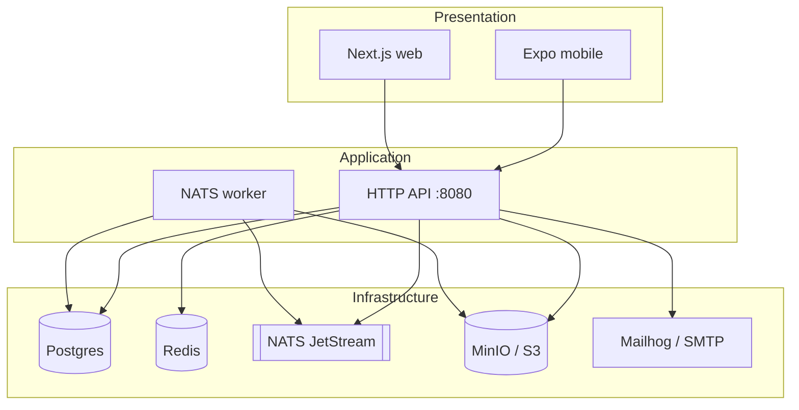

# Arquitectura

## Vista general

## Límites

- **mobile / web**: UI y sesión; no hablan con Postgres directo.
- **api**: auth JWT, eventos, pagos (fake / Mercado Pago), media firmada, tickets.
- **worker**: jobs async (media, emails, expiry, recs).

## Contratos

OpenAPI: `apps/api/openapi.yaml`. Features API: `apps/api/docs/features/`. Features mobile/web: `apps/*/docs/features/`.

## Monorepo (simple)

Historiales de tres repos unidos con `git filter-repo` bajo `apps/{mobile,api,web}`.

No hay workspace compartido: cada app instala y corre sola. La raíz solo tiene docs, CI path-filtered y scripts atajo.
